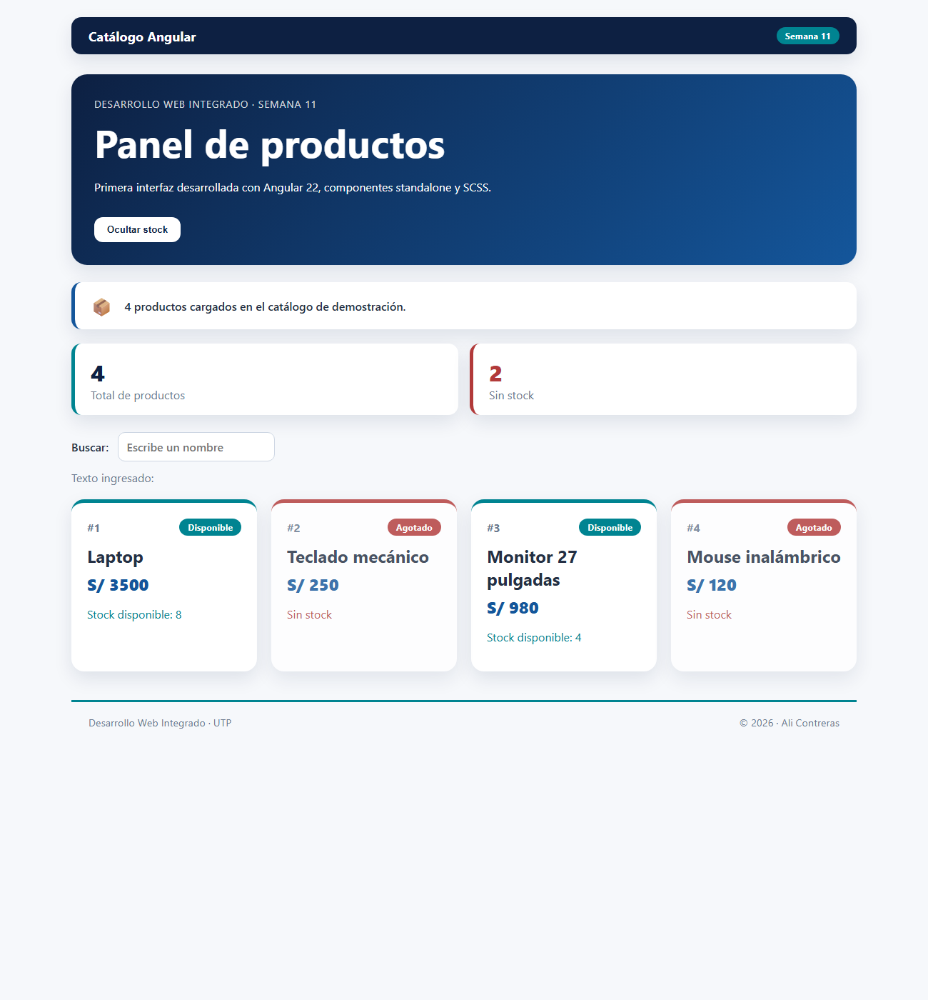
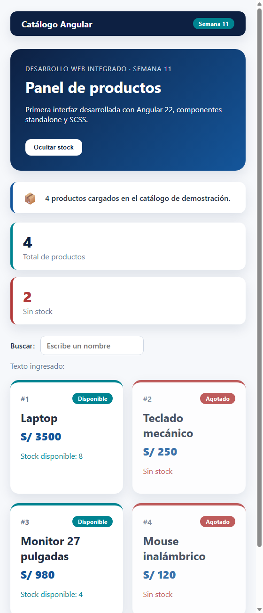

# Ali_Contreras — Guía de Laboratorio 11

**Curso:** Desarrollo Web Integrado (100000ST61) — Semana 11 (inicio de la Unidad 3)
**Proyecto:** `catalogo-angular` — Panel de productos con Angular 22, componentes standalone y SCSS

Primera interfaz de la capa de presentación. Construye un catálogo con componentes, control de
flujo (`@if` / `@for`) y estilos SCSS organizados. **Todavía no consume el back-end** Spring Boot:
rutas, `HttpClient` y formularios corresponden a las semanas 12 a 14.



## Entorno (E1)

```
node -v      → v24.22.1
npm -v       → 11.19.1
ng version   → Angular CLI 22.2.4 · Angular 22.2
```

> Angular CLI 22 exige **Node.js 22.22.3+ o 24.15.0+**. Con Node 24.13 el CLI se niega a ejecutarse
> ("The Angular CLI requires a minimum Node.js version…"); se resolvió actualizando Node LTS a 24.22.1
> (`winget upgrade OpenJS.NodeJS.LTS`).

## Cómo ejecutar

```bash
npm install -g @angular/cli      # solo la primera vez
npm install                      # instala dependencias (node_modules no se versiona)
npm start                        # http://localhost:4200/
```

Otros comandos:

```bash
ng build                         # build de producción en dist/catalogo-angular
ng test --watch=false            # pruebas unitarias (Vitest)
```

## Creación del proyecto (paso 4)

```bash
ng new catalogo-angular --style=scss --routing=false --standalone --file-name-style-guide=2025 \
       --skip-git --ssr=false
```

- `--style=scss`: SASS/SCSS desde el inicio.
- `--routing=false`: las rutas se verán en la semana 12.
- `--standalone` y `--file-name-style-guide=2025`: modelo y nombres actuales (`app.ts`, `app.html`).
- `--skip-git`: el proyecto vive dentro del repositorio del grupo, no necesita un Git propio.
- `--ssr=false`: no se requiere renderizado en servidor.

## Estructura (E3)

```
src/
├── main.ts                         # arranque de la aplicación
├── index.html
├── styles.scss                     # estilos globales
├── styles/
│   └── _tokens.scss                # partial SCSS: colores, medidas y mixins (@use)
└── app/
    ├── app.ts / app.html / app.scss   # componente raíz: catálogo, métricas y búsqueda
    ├── app.spec.ts
    ├── shared/
    │   ├── app-header/             # ng g c shared/app-header --style=scss
    │   └── app-footer/             # ng g c shared/app-footer --style=scss
    └── features/
        └── summary-panel/          # ng g c features/summary-panel --style=scss
```

Los tres componentes se generaron con **Angular CLI** (E5), se importaron en el arreglo `imports`
de `App` y se insertaron con sus selectores: `<app-header>`, `<app-summary-panel>` y `<app-footer>`.

## Conceptos de Angular aplicados (E4)

| Sintaxis | Concepto | Dónde |
|----------|----------|-------|
| `{{ titulo }}` | Interpolación | Título, precios, métricas |
| `(click)="alternarStock()"` | Event binding | Botón mostrar/ocultar stock y "Limpiar" |
| `[class.out-of-stock]="producto.stock === 0"` | Class binding | Tarjetas agotadas |
| `@for (...; track producto.id) { } @empty { }` | Control de flujo | Lista de productos |
| `@if (...) { } @else { }` | Control de flujo | Disponible/Agotado y visibilidad del stock |
| `signal()` y `computed()` | Estado reactivo | `mostrarStock`, `busqueda`, `productosFiltrados` |
| `[(ngModel)]="busqueda"` | Two-way binding (opcional) | Buscador que además filtra el catálogo |

> Angular 22 funciona sin `zone.js` (*zoneless*): por eso el estado que cambia se maneja con
> **signals**, que avisan a Angular cuándo redibujar la vista.

## SCSS (E6)

`src/styles/_tokens.scss` es un **partial** con los tokens de diseño, reutilizado en cada
componente con `@use '…/styles/tokens' as *;`:

| Recurso | Ejemplo |
|---------|---------|
| Variables | `$navy`, `$blue`, `$teal`, `$danger`, `$radius-lg`, `$breakpoint-md` |
| Mixins | `card-shadow`, `pill($bg)` (etiquetas), `responsive-md` (con `@content`) |
| Anidamiento | `.hero { h1 { … } button { &:hover { … } } }` |
| Selector padre `&` | `&.out-of-stock`, `&__brand`, `&--danger` |
| Módulos | `@use` del partial de tokens |

## Reto de consolidación (sección 12)

**Requisitos mínimos:**

- [x] Cuatro productos con `id`, `nombre`, `precio` y `stock`.
- [x] `@for` para renderizar la colección (con `@empty`).
- [x] `@if` para distinguir stock disponible y agotado.
- [x] Event binding: botón que muestra u oculta el stock.
- [x] Tres componentes adicionales generados con el CLI (`app-header`, `app-footer`, `summary-panel`).
- [x] SCSS con variables, anidamiento y mixins.
- [x] Nombres de archivos y carpetas según la guía de estilo 2025.
- [x] `ng build` sin errores.

**Extensión recomendada:**

- [x] Etiqueta visual **Disponible** / **Agotado**.
- [x] Métricas: total de productos (4) y total sin stock (2).
- [x] Diseño responsive con CSS Grid y Flexbox.
- [x] Partial SCSS de tokens reutilizado con `@use`.

El panel de resumen muestra un texto estático, como indica la guía: pasarle datos desde el padre
requiere `@Input`, que corresponde a la semana 12.

## Verificación

| Comprobación | Resultado |
|--------------|-----------|
| `npm start` → http://localhost:4200/ | Abre sin errores de compilación (E2) |
| Consola del navegador | 0 errores |
| Título, 4 productos con `@for`, agotados resaltados | Correcto |
| Botón alterna la visibilidad del stock | Correcto |
| `app-header`, `summary-panel`, `app-footer` visibles | Correcto |
| `[(ngModel)]` actualiza el texto y filtra en tiempo real | Correcto |
| Pantalla angosta | Métricas en una columna, tarjetas reacomodadas (E7) |
| `ng test --watch=false` | **9 pruebas aprobadas** (6 del componente raíz y 3 de los componentes generados) |
| `ng build` | Build de producción sin errores ni advertencias (E8) |



Las pruebas del componente raíz verifican: título y componentes hijos, 4 tarjetas con 2 agotadas,
métricas `4` / `2`, que el botón oculte y muestre el stock, y que `[(ngModel)]` filtre el catálogo y
muestre `@empty` cuando no hay coincidencias.

## Preguntas de cierre

1. **¿Por qué Angular necesita Node.js si se ejecuta en el navegador?** Node ejecuta las
   herramientas de desarrollo: Angular CLI, el compilador de TypeScript y SCSS, el servidor de
   desarrollo y el empaquetado. El navegador solo recibe el resultado compilado (JS y CSS).
2. **Angular vs. Angular CLI:** Angular es el framework con el que se construye la interfaz;
   Angular CLI es la herramienta de línea de comandos que crea proyectos, genera componentes,
   ejecuta el servidor, las pruebas y el build.
3. **Ventaja de dividir en componentes:** cada pieza tiene su lógica, plantilla y estilos
   encapsulados; se reutiliza, se prueba por separado y el código es más fácil de mantener.
4. **¿Qué es un componente standalone?** Uno que declara directamente lo que usa en su propio
   arreglo `imports`, sin depender de un `NgModule`.
5. **Interpolación, property binding y event binding:** la interpolación `{{ }}` muestra un valor
   como texto; el property binding `[prop]` asigna un valor a una propiedad del elemento (como
   `[class.out-of-stock]`); el event binding `(evento)` ejecuta un método cuando ocurre un evento.
6. **¿Cuándo `@if` y cuándo `@for`?** `@if` para mostrar u ocultar contenido según una condición;
   `@for` para repetir una plantilla por cada elemento de una colección.
7. **Ventajas de SCSS:** variables y mixins evitan repetir valores y reglas, el anidamiento agrupa
   estilos relacionados y `@use` separa los tokens en archivos reutilizables.
8. **¿Por qué aún no consumimos el API Spring Boot?** Primero hay que dominar la base de Angular
   (componentes, plantillas y estilos). El consumo HTTP se agrega en la semana 14, sobre una
   interfaz ya organizada.
