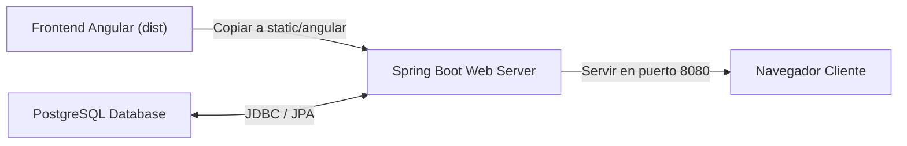

# GUÍA DE LABORATORIO N.° 16: DESPLIEGUE CONTINUO Y DOCKERIZACIÓN
## CURSO: DESARROLLO WEB INTEGRADO — SEMANA 16
### ESTUDIANTE: ANTONELA JAIMES | UNIVERSIDAD TECNOLÓGICA DEL PERÚ

---

## 1. Objetivos del Laboratorio 16
* Automatizar el ciclo de empaquetado del frontend (Angular) y backend (Spring Boot).
* Configurar la orquestación de servicios mediante `compose.yaml` para la base de datos PostgreSQL y la aplicación web.
* Implementar scripts de inicio en PowerShell (`iniciar.ps1`) para compilación y ejecución en un solo comando.
* Aplicar buenas prácticas de integración continua (CI/CD) para garantizar despliegues reproducibles.

---

## 2. Arquitectura de Despliegue Unificado

El despliegue integra el cliente SPA compilado dentro de los recursos estáticos del servidor Spring Boot:



### Script de Automatización (`iniciar.ps1`)
El script automatiza:
1. Verificación y asignación de `JAVA_HOME` (Java 17).
2. Compilación optimizada de Angular con `npm run build`.
3. Copia automática del bundle hacia `src/main/resources/static/angular`.
4. Ejecución del backend con `mvnw spring-boot:run` en `http://localhost:8080`.

---

## 3. Configuración de Contenedores (`compose.yaml`)
```yaml
services:
  db:
    image: 'postgres:15-alpine'
    environment:
      - 'POSTGRES_DB=proyectomdweb'
      - 'POSTGRES_PASSWORD=postgres'
      - 'POSTGRES_USER=postgres'
    ports:
      - '5432:5432'
    volumes:
      - pgdata:/var/lib/postgresql/data

volumes:
  pgdata:
```

---

## 4. Conclusiones
* La automatización mediante scripts de despliegue reduce drásticamente el error humano durante la puesta en marcha.
* Servir el bundle estático de Angular desde el servidor embebido de Spring Boot elimina problemas de CORS en producción y simplifica el dominio de acceso a un solo host y puerto.
