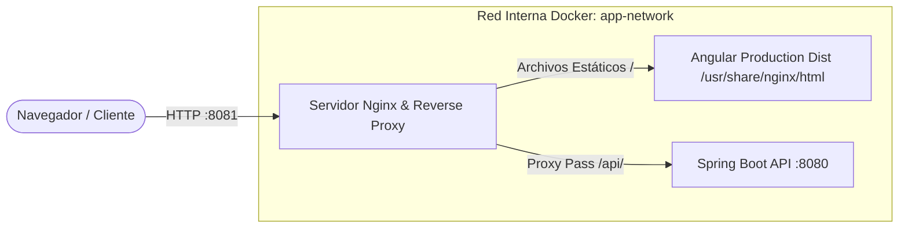

# Laboratorio 17: Despliegue de Aplicaciones Web con Docker y Nginx Reverse Proxy

**Curso:** Desarrollo Web Integrado (DWI) - UTP  
**Estudiante:** Ali Contreras  
**Fecha:** Noviembre 2026  

---

## 1. Descripción del Laboratorio

En este laboratorio se diseñó e implementó la arquitectura completa de despliegue para una solución web desacoplada compuesta por:
1. **Frontend:** Aplicación Angular compilada en producción y servida mediante el servidor web **Nginx**.
2. **Backend:** API REST desarrollada con **Spring Boot 3** empaquetada en un contenedor Docker con Java 21 Alpine.
3. **Reverse Proxy (Nginx):** Configurado para enrutar transparentemente las peticiones `/api/*` hacia el microservicio backend en una red interna privada, evitando la necesidad de habilitar CORS y aislando el backend de accesos no autorizados.
4. **Orquestación con Docker Compose:** Creación de redes bridge (`app-network`), gestión de dependencias de arranque (`depends_on`), y mapeo de puertos estandarizado (Frontend en `:8081` y Backend en `:8080`).

---

## 2. Arquitectura de la Solución



---

## 3. Estructura del Proyecto

```text
Laboratorio17/Ali_Contreras/
├── README.md
└── lab-despliegue-web/
    ├── docker-compose.yml
    ├── backend-deploy/
    │   ├── Dockerfile
    │   ├── pom.xml
    │   └── src/
    │       └── main/
    │           ├── java/com/utp/backend_deploy/
    │           │   ├── BackendDeployApplication.java
    │           │   └── controller/
    │           │       └── EstadoController.java
    │           └── resources/
    │               └── application.properties
    └── frontend-deploy/
        ├── Dockerfile
        ├── nginx.conf
        ├── package.json
        ├── proxy.conf.json
        ├── angular.json
        ├── tsconfig.json
        └── src/
            ├── index.html
            ├── main.ts
            └── app/
                ├── services/
                │   └── estado.service.ts
                └── pages/
                    └── inicio/
                        ├── inicio.component.ts
                        ├── inicio.component.html
                        └── inicio.component.css
```

---

## 4. Archivos Clave y Configuraciones

### 4.1. Configuración de Nginx (`frontend-deploy/nginx.conf`)
```nginx
server {
    listen 80;
    server_name localhost;

    location / {
        root /usr/share/nginx/html;
        index index.html index.htm;
        try_files $uri $uri/ /index.html;
    }

    location /api/ {
        proxy_pass http://backend:8080/api/;
        proxy_http_version 1.1;
        proxy_set_header Host $host;
        proxy_set_header X-Real-IP $remote_addr;
        proxy_set_header X-Forwarded-For $proxy_add_x_forwarded_for;
        proxy_set_header X-Forwarded-Proto $scheme;
    }
}
```

### 4.2. Docker Compose (`docker-compose.yml`)
```yaml
version: '3.8'

services:
  backend:
    build:
      context: ./backend-deploy
      dockerfile: Dockerfile
    container_name: backend-deploy-container
    ports:
      - "8080:8080"
    networks:
      - app-network

  frontend:
    build:
      context: ./frontend-deploy
      dockerfile: Dockerfile
    container_name: frontend-deploy-container
    ports:
      - "8081:80"
    depends_on:
      - backend
    networks:
      - app-network

networks:
  app-network:
    driver: bridge
```

---

## 5. Instrucciones de Ejecución

1. **Construir y levantar contenedores:**
   ```bash
   cd lab-despliegue-web
   docker compose up -d --build
   ```

2. **Verificar estado de los contenedores:**
   ```bash
   docker ps
   ```

3. **Acceso al sistema:**
   - **Frontend:** [http://localhost:8081](http://localhost:8081)
   - **Endpoint REST:** [http://localhost:8080/api/estado](http://localhost:8080/api/estado)
